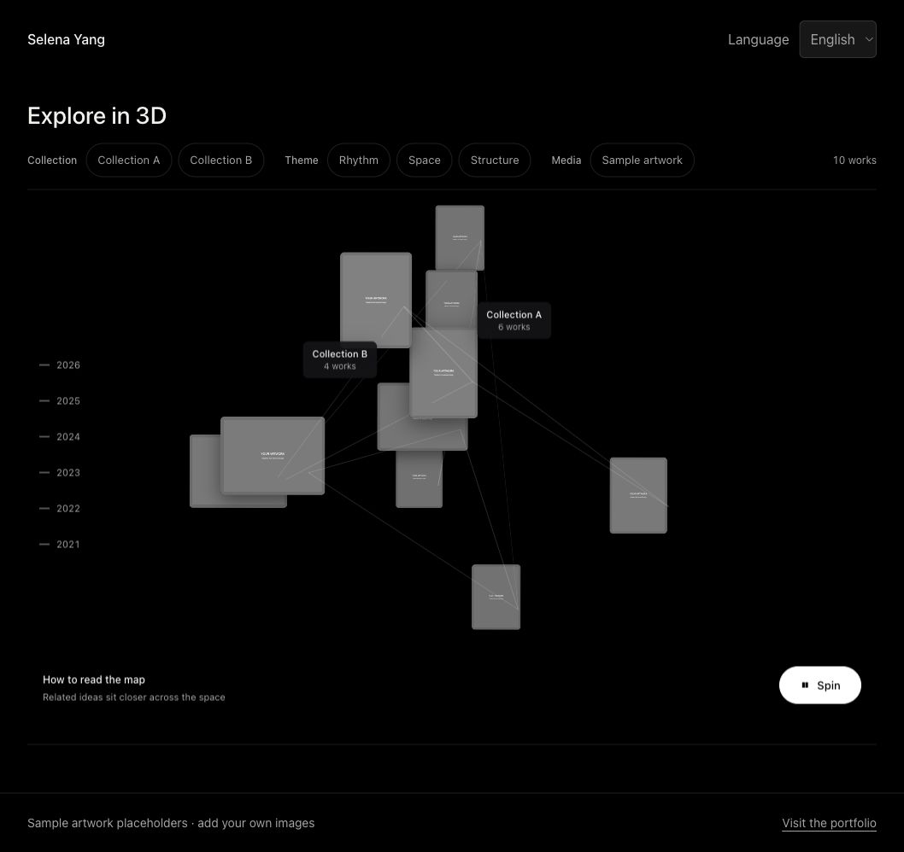

# Explore in 3D

A spatial artwork browser extracted from [Selena Yang's art portfolio](https://selenayang.art/#explore-3d).



Paintings form a rotatable semantic map. Related works sit near each other, chronology contributes the vertical structure, and subtle links show relationships. Visitors can filter by collection, theme, or medium, inspect relationships, and open artwork details.

## Run locally

Requires Node.js 20 or newer. No dependency installation or build step is needed.

```sh
npm start -- --port 4174
```

Open `http://127.0.0.1:4174`. Use another port if it is occupied.

```sh
npm test
```

## How it works

This is **CSS 3D**, not Three.js or a WebGL scene. The algorithm builds local TF-IDF-style text features from artwork titles, descriptions, collection/theme/medium metadata, and optional semantic tags. Similarity helps position works and connect neighboring pieces. It does not call an AI model, embedding API, or remote vector database.

- Drag to orbit, scroll to zoom, or use the stage's keyboard controls.
- Pause automatic rotation; reduced-motion preferences disable the initial spin.
- Multi-select filters combine selections within each group and intersect across groups.
- Year and collection controls highlight related works.
- Hover/focus previews and click-through artwork details use the same local dataset.
- English, Chinese, and Korean dictionaries are included; some inherited text remains English.

## Replace the artwork

Edit `data/works.js`, which assigns an array to `window.WORKS`:

```js
{
  title: 'Your artwork',
  slug: 'your-artwork',
  year: 2026,
  medium: 'Acrylic on canvas',
  dimensions: '36 x 24 in',
  imagePath: 'images/art/your-artwork.webp',
  collection: 'Your collection',
  theme: 'Growth & Biology',
  seoDescription: 'A short description of the work.',
  semanticProfile: {
    concepts: ['growth'],
    motifs: ['branching pathways'],
    values: ['wonder'],
    context: ['biology']
  }
}
```

Each work needs a unique `slug`, a valid local image, and a year. Optional `embeddingTags` and `embeddingNudge` refine the inherited layout. This is a small-gallery prototype; thousands of artworks would require a different rendering and similarity strategy. Use trusted, locally maintained catalog content, not unsanitized user submissions.

The shipped `DEMO_ITEMS` are generic examples using two gray SVG placeholders. Change the entries or supply your own `window.WORKS` data and images that you are allowed to share. No Selena Yang paintings are included.

The two sample collection descriptions are mapped in `src/explore.js` (`COLLECTION_DESCRIPTIONS`); update that mapping and `data/translations.js` when substituting your collections.

## Structure

| Path | Purpose |
| --- | --- |
| `src/explore.js` | Similarity calculations, CSS 3D layout, orbiting, filtering, previews |
| `src/artwork-details.js` | Native artwork dialog and focus return |
| `src/i18n.js` / `data/translations.js` | Language switch and feature-specific labels |
| `data/works.js` | Public demo catalog; no commerce credentials or private records |
| `styles/feature.css` | Extracted map styling and responsive rules |
| `styles/base.css` | Standalone page and dialog styling |
| `scripts/serve.mjs` | Dependency-free local server |
| `tests/` | Catalog, syntax, asset, and safety checks |

The map mounts into `#explore-mount`. Without that element, the inherited `Explore.open()` / `Explore.close()` API can show a focused overlay. This extraction is intended for a persistent page and does not yet expose an SPA teardown API.

## Publish

Serve the repository root on GitHub Pages or another static host. No build command is required. Asset paths are relative to support project subdirectories. This is independent from the existing portfolio deployment.

There is no tracking, customer data, Shopify integration, or external API dependency in this demo. Opening the portfolio link is optional.

## Rights

No artwork by Selena Yang is included. This repository does not yet grant an open-source code license; see [RIGHTS.md](RIGHTS.md) and [ASSETS.md](ASSETS.md).
